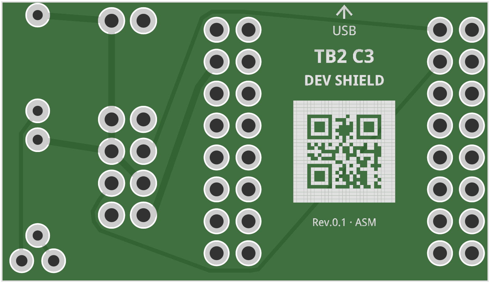
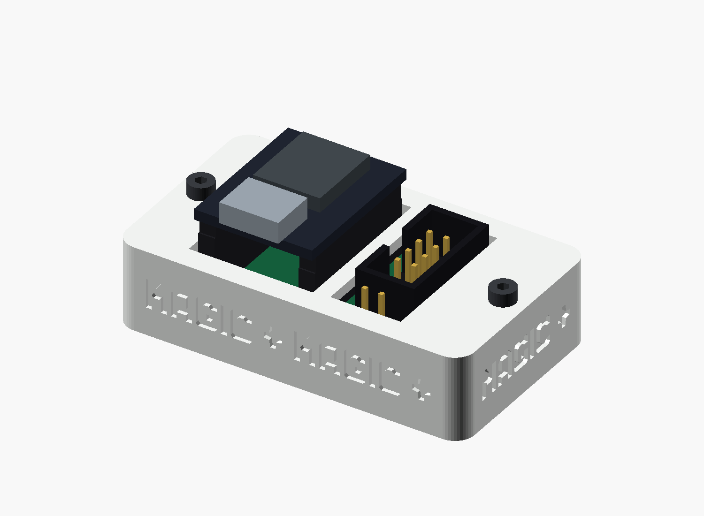

# TB2 C3 Dev Shield

A compact **3.3 V SPI shield for the ESP32-C3 SuperMini**, connecting an SOP8 clip cable to the flash chip of a Toniebox 2. The **39 × 22.52 mm** board provides a target-power jumper, a /CS pull-up and an optional ACT indicator. All parts are through-hole for hand soldering.

**Hardware Rev. 0.1 — unverified build candidate.** The Fritzing design and manufacturing files have passed the documented electrical and geometry checks. Physical fit, supply behaviour and flash readback tests are still pending.

## Manufacture or modify the shield

- **[Release v0.1.0 with PCBWay files](/Netfreak25/TB2-C3-Dev-Shield/releases/tag/v0.1.0)**
- **[PCBWay ordering guide](docs/pcbway-ordering.md)** for bare PCBs or optional factory assembly, including a [50-board cost example](docs/pcbway-ordering.md#3-example-cost-for-50-bare-pcbs).
- **[Editable Fritzing design](hardware/TB2-C3-Dev-Shield-Assembly-Rev0.1.fzz)** and [editing notes](docs/editing.md).
- [Pin mapping, soldering and operation](docs/hardware.md), [assembly instructions](docs/Assembly.pdf) and [schematic](docs/Schematic.svg).
- [Validation status](docs/validation.md) and [export checks](docs/export-check.json).

The same Gerber package serves both ordering options. For hand assembly, order **unpopulated single PCBs** and leave Assembly Service disabled. The BOM describes the complete socket-mounted shield; the ESP32 module and cable are separate.

## Board functions

| Function | Implementation |
|---|---|
| ESP32 connection | Two 1×8 sockets, 2.54 mm pitch and 15.24 mm row spacing; module inserted from above, USB pointing toward the arrow |
| Flash connection | J1: straight, upward-facing 2×4 shrouded header, 2.54 mm pitch; notch to the left |
| POWER | JP1 disconnects the target's 3.3 V supply when its shunt is removed |
| /CS pull-up | R1: 10 kΩ to the target supply, after JP1 |
| ACT | R2: 1 kΩ and D1: red 3 mm LED, driven by active-low /CS |
| Alternative mounting | Paired outer solder lands for a matching castellated SuperMini; requires a physical fit check |
| Marking | Board name, USB arrow and a QR containing the text `Netfreak` on both sides |

The rear marking remains visible with the ESP32 installed. It is oriented to read normally from the back.

## Components

| Parts | Purpose / reference |
|---|---|
| JL/JR | Two Würth 61300811821 female socket strips; populate the inner rows |
| J1 | Würth 61200821621 straight 2×4 shrouded header |
| JP1 | Würth 61300211121 two-pin power header |
| R1 | 10 kΩ /CS pull-up; retain this resistor in a minimal build |
| R2 | 1 kΩ ACT LED current-limiting resistor |
| D1 | Kingbright WP710A10LID red low-current LED |

The [complete BOM](manufacturing/pcbway/BOM.csv) contains **7 THT components in 6 grouped positions**, with **32 solder joints and no SMD parts**. R2 and D1 can both be omitted when an ACT indicator is not needed; no replacement bridge is required. The full factory-assembly BOM includes them.

For factory assembly, JP1 includes **the two pins only**: no removable shunt is supplied or fitted. Add your own 2.54 mm shunt to enable target power after inspection. The ESP32 SuperMini, its male headers and the SOP8 clip cable are not included in the BOM.

## Printable flat dock

The optional white [two-piece flat dock](enclosure/README.md), with `MAGIC` lettering on all four sides and an ACT light-guiding tube beneath a single-layer cover, protects the shield underside while leaving the ESP32, USB-C, buttons, cable connector and power jumper accessible. OpenSCAD source, separate STL files and assembly instructions are included. **The enclosure is an unverified build candidate; physical print and fit tests are pending.**

## Firmware and browser connection

The [C3 serprog flasher v0.1](firmware/flasher-v0.1/README.md) provides the source and the three flashable images for SPI2 with /CS = GPIO4, MISO = GPIO5, CLK = GPIO6 and MOSI = GPIO7. It uses the ESP32-C3's native serial USB port and has Wi-Fi disabled. A compatible browser application connects through **WebSerial**. The shield itself is passive and needs no firmware.

For the first read-only backup, follow the [PowerShell/flashrom procedure](docs/first-dump.md) and [hardware checks](docs/hardware.md#firmware-and-webserial). This board is the ESP32-C3 counterpart to the [Flipper TB2 Dev Board](https://github.com/Netfreak25/TB2-Dev-Board); the two hosts use different GPIO assignments and USB interfaces.

## Before connecting

Use a compatible **3.3 V target**. Disconnect the target battery and target USB before attaching the clip. Check the module orientation, cable continuity, chip pin 1 and supply voltage before applying power.

JP1 interrupts only the target supply. It does **not** isolate the SPI signals or prevent backfeeding through them. ACT indicates /CS activity, not successful data transfer.

## License

The hardware design and accompanying source material are licensed under the [CERN Open Hardware Licence Version 2 — Permissive](LICENSE). The separately packaged [serprog firmware](firmware/flasher-v0.1/README.md) is licensed under GPLv3.
