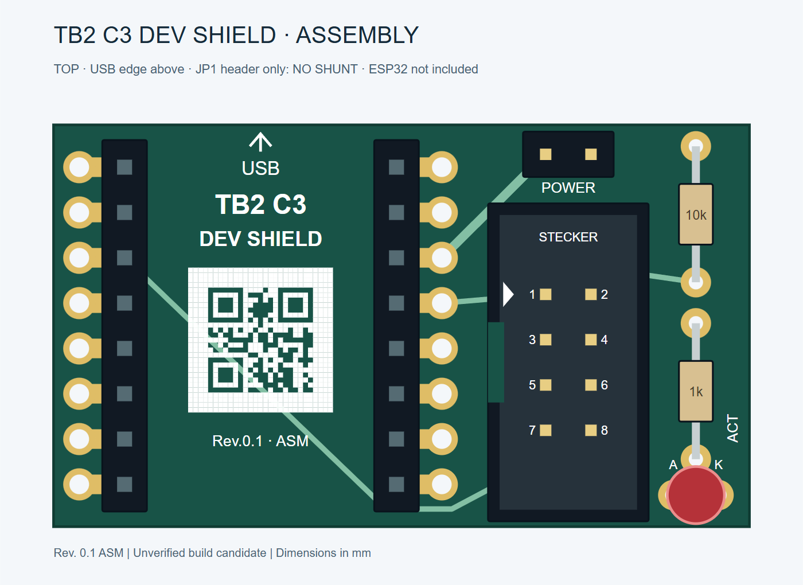

# Hardware, pin mapping and operation

## Orientation and mounting

View the shield from above with the **USB arrow pointing up**. The SuperMini sits above the left section of the shield; J1, JP1, R1, R2 and D1 sit on the right. J1 is a **straight vertical 2×4 header**, with its opening upward, notch left and pin 1 nearest the USB edge.



The nominal SuperMini outline is 18 × 22.52 mm. The shield is 39 × 22.52 mm. The two module rows have **2.54 mm pitch and 15.24 mm separation**. SuperMini variants must be checked against the footprint before soldering.

Two mounting options share the PCB:

- **Socket mounted:** populate the two inner 1×8 rows with female sockets, opening upward. The module's male header pins point downward. Leave all 16 outer duplicate pads empty.
- **Direct soldered:** leave the sockets out and use the exposed outer lands with a mechanically compatible castellated SuperMini. Actual module edge contacts, underside clearance and soldering access require verification.

Factory assembly uses the socket-mounted option. Do not install a directly soldered module over fitted sockets. The shield's 32 module holes are **1.10 mm**; this does not describe or alter the holes in the SuperMini itself.

## J1 and SOP8 mapping

The numbers on J1 are **connector contact numbers**, not SOP8 chip pin numbers. Check the actual cable through to the clip before first use.

| ESP32 / supply | J1 contact | SOP8 chip pin | Signal |
|---|---:|---:|---|
| GPIO4 | 1 | 1 | /CS |
| GPIO5 | 3 | 2 | MISO / DO |
| GPIO6 | 6 | 6 | CLK |
| GPIO7 | 8 | 5 | MOSI / DI |
| GND | 7 | 4 | GND |
| Target 3.3 V after JP1 | 2 | 8 | VCC |
| Target 3.3 V after JP1 | 5 | 3 | /WP |
| Target 3.3 V after JP1 | 4 | 7 | /HOLD |

```text
Top view, USB edge above

Pin 1 mark ->  1 /CS     2 VCC
              3 MISO    4 /HOLD
              5 /WP     6 CLK
              7 GND     8 MOSI

J1 notch: LEFT; mating opening: UP
```

## Power, pull-up and ACT

```text
ESP32 3V3 -> JP1.1  [removable shunt]  JP1.2 -> Target 3V3
                                               |-> J1.2 VCC
                                               |-> J1.5 /WP
                                               |-> J1.4 /HOLD
                                               |-> R1 10k -> /CS
                                               `-> R2 1k -> LED anode
                                                            LED cathode -> /CS
```

R1 holds /CS high relative to the **target supply after JP1**. Retain it in the minimal build. Removing the JP1 shunt interrupts only the direct target supply; GND and SPI remain connected, so signal-line backfeeding is still possible. Stop transfers and disconnect USB before changing the wiring.

The red ACT LED lights while /CS is low. It may flicker or appear steady during repeated accesses. It does not confirm transfer success. **R2 and D1 are optional as a pair**: leave both footprints empty if no indicator is wanted; do not bridge either footprint.

## Hand assembly

1. With everything unpowered, check the PCB, module row spacing and component fit. Use the [BOM](../manufacturing/pcbway/BOM.csv) and [assembly PDF](Assembly.pdf).
2. Fit R1 = 10 kΩ. Fit R2 = 1 kΩ only when installing D1. Form the resistor leads to 7.62 mm spacing without stressing the body.
3. Align the two female socket rows with a mating fixture or the unpowered module. Tack, check the fit, then finish the socket joints; remove the module before continuing.
4. Fit J1 with the notch left and pin 1 toward USB. Fit the two JP1 pins without a shunt or solder bridge between them.
5. If desired, fit D1 upright: **anode left, cathode right** toward the outer edge. Check the flat-side/cathode marking against the reference datasheet.
6. Inspect for solder bridges, check the connections below, then insert the SuperMini with USB pointing toward the arrow. Fit your own 2.54 mm shunt only when ready to enable target power.

For factory-assembled boards, begin with inspection and continuity checks. The ESP32 and JP1 shunt are supplied separately by the user.

## Firmware and WebSerial

The interface contract is **serprog on the native serial USB port**, using SPI2 with /CS = GPIO4, MISO = GPIO5, CLK = GPIO6 and MOSI = GPIO7. The [flasher v0.1 package](../firmware/flasher-v0.1/README.md) contains the matching source and ESP32-C3 images, with Wi-Fi disabled. Flashing the ESP32-C3 and recognizing its serial port do not establish a working connection to the target flash.

For browser use, a compatible application can implement serprog over **WebSerial** through the ESP32-C3 serial port and a data-capable USB cable. The [first-dump procedure](first-dump.md) uses PowerShell and flashrom. Do not treat this as a Flipper WebUSB bridge. GPIO18/19 belong to the ESP32-C3's native USB connection and are not used for the target SPI bus. See [Espressif's USB Serial/JTAG documentation](https://docs.espressif.com/projects/esp-idf/en/stable/esp32c3/api-guides/usb-serial-jtag-console.html).

## First-use checks

The target's battery and USB supply must remain disconnected.

1. **Unpowered:** check continuity from the module pads through the cable to every SOP8 contact. Check adjacent contacts, 3.3 V and GND for unintended shorts. R1 and the LED branch are intentional component paths, not direct copper shorts.
2. **JP1 open:** verify that its two pins have no direct copper bridge. Confirm R1 connects /CS to the target side of JP1.
3. **Without a target:** verify 3.3 V, polarity and jumper operation. Then check the supply under the intended load. An open jumper does not guarantee a zero-voltage target when SPI signals are driven.
4. **First-dump acceptance:** follow the [PowerShell/flashrom first-dump procedure](first-dump.md), starting at 500 kHz. For the intended 16 MiB flash, compare three complete 16,777,216-byte reads with one another and with a known-good dump of the same unchanged flash when available. Check ACT if fitted. Do not program or erase flash during this acceptance step.

Mechanical fit, real supply behaviour and these readback checks remain open. See the [validation record](validation.md).
