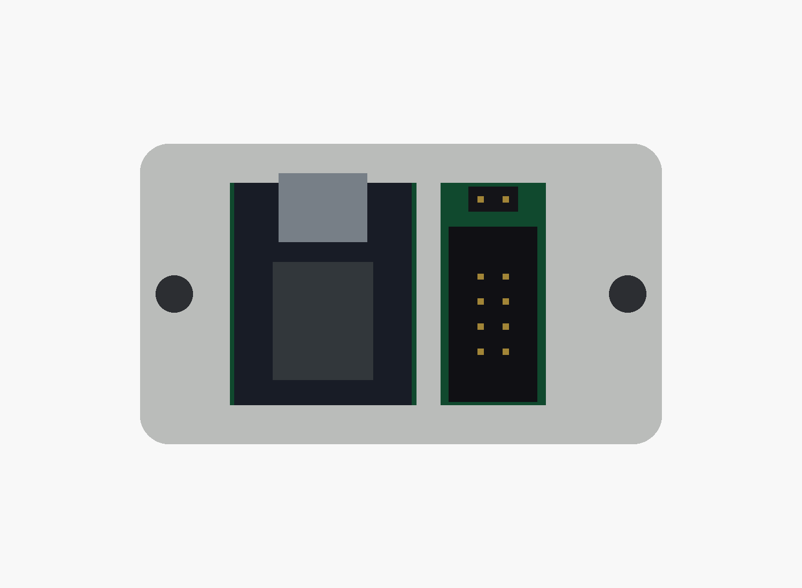
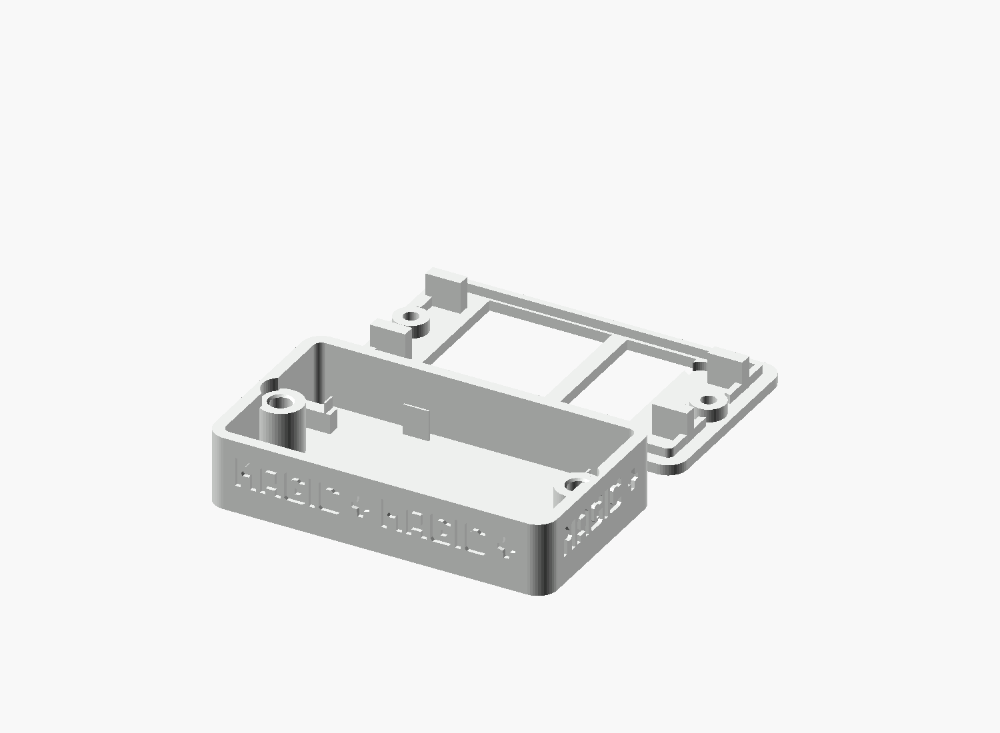
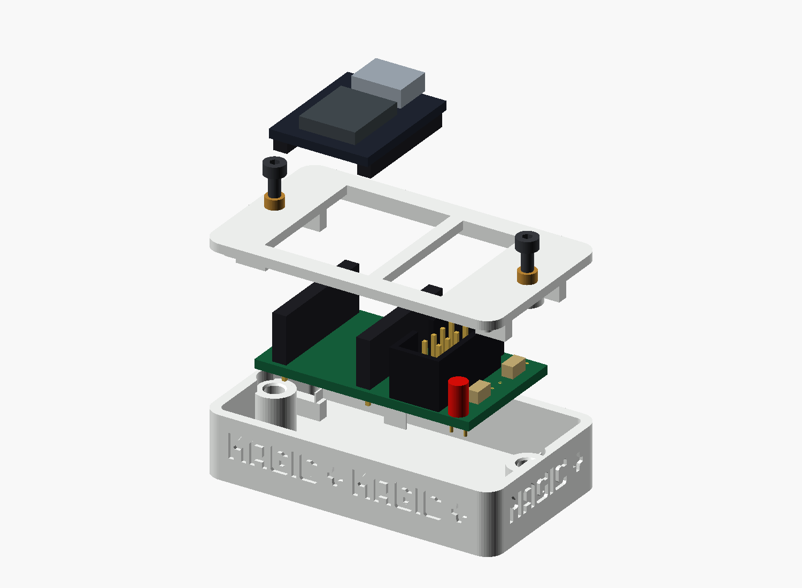

# TB2 C3 flat dock

A compact, two-piece dock for the **socket-mounted TB2 C3 Dev Shield Rev. 0.1**. The white rounded base protects the shield underside; the white flat lid retains its edges. The ESP32 remains exposed, leaving USB-C, BOOT and RESET accessible. The shrouded cable connector and power jumper are accessible from above, with ACT hidden behind a continuous, single-layer white skin. Six **MAGIC** words and five four-point stars decorate all four sidewalls, using the geometric lettering of the original enclosure.

**Enclosure Rev. 0.3 — unverified build candidate.** The meshes and nominal component clearances have been checked digitally. No print or physical fit test has been performed. The electronics in these previews are simplified dimensional references.


**Rev. 0.3 corrects the PCB-to-CAD orientation. Replace earlier enclosure exports before printing; their layout was reflected relative to the PCB.**

## Orientation

Viewed from above with USB-C at the top: the ESP32 is on the left, POWER is at the upper right, J1 is below POWER, and ACT is at the lower right under the white skin. This matches the PCB top view.



## Files

| File | Use |
|---|---|
| [TB2_C3_Case.scad](TB2_C3_Case.scad) | Editable, standalone OpenSCAD source |
| [TB2_C3_Case_base.stl](TB2_C3_Case_base.stl) | Base, already oriented with its floor on the print bed |
| [TB2_C3_Case_lid.stl](TB2_C3_Case_lid.stl) | Lid, already oriented with its outside face on the print bed |
| [Exploded view](exploded.png) | Parts and assembly arrangement |
| [Top view](top.png) / [section](section.png) / [print layout](layout.png) | Internal clearances and print orientation |
| [Validation results](validation.json) | Mesh hashes and nominal collision results |

## Size and hardware

| Item | Nominal value |
|---|---|
| Printed enclosure, assembled | **53 × 30.52 × 12.8 mm** |
| Assembly height including the ESP32 USB shell | About **22 mm**, dependent on the module and headers |
| Shield PCB | 39 × 22.52 × 1.6 mm |
| Floor / walls / lid | 1.6 / 1.8 / 1.6 mm |
| White skin over ACT | **0.2 mm**, one layer with a 0.2 mm first-layer height; nominal 0.9 mm clearance above the LED |
| PCB underside above the inside floor | 3 mm; trim soldered leads to no more than 2 mm below the PCB |
| PCB lateral clearance / vertical retention gap | 0.3 mm per side / 0.2 mm nominal |
| ESP32 socket body / male header spacer | 8.5 / 2.5 mm nominal |
| Fasteners | **2 × M2×8 cylinder-head screws**, nominal head Ø3.8 × 2 mm |
| Inserts | **2 × M2 heat-set inserts, 3 mm long, nominal Ø3.2 mm outside** |
| Insert seats | Ø3.2 mm, with an entry chamfer; insert top 0.2 mm below its boss |

The screws sit outside the PCB. Four small edge supports and matching lid retainers locate it without drilling the board. The screw load is carried by plastic bosses, not by the PCB. The supplied geometry gives 3 mm of insert thread engagement and 0.8 mm clearance below the screw tip.

The dock is designed for the socket-mounted module. **Direct-solder mounting has not been fitted to this enclosure.** Different socket heights, male header spacers, LEDs, cable plugs or insert profiles can require parameter changes. A nominal insert diameter does not guarantee the same heat-fit behaviour across brands or printers.

## Print

Print one base and one lid. The supplied STLs are separate parts in their intended print orientation; do not rotate the lid upright for printing.

- White PLA, 0.4 mm nozzle, **0.2 mm first layer and subsequent layers**. The first layer of the inverted lid forms the LED skin. Suggested starting settings: four perimeters, five top/bottom layers and 20% infill.
- Both base and lid are white. The recessed `MAGIC` lettering and stars can be left white or paint-filled with the original orange accent colour. These are single-material STL parts; no separate colour inlay is required.
- Supports are not expected for the intended orientation. Inspect your slicer's preview, especially the small insert entry chamfers; this package has not been sliced or test-printed.
- Use a brim only if needed for adhesion. No printer-specific G-code is included.



## Assemble

1. Check that the shield and actual connector bodies match the dimensions above. Remove the ESP32, cable and power-jumper shunt; keep USB unplugged.
2. Install the two heat-set inserts in the **empty base**, before adding electronics. Set their top faces 0.2 mm below the boss surfaces. Let the base cool and check screw engagement.
3. Inspect the shield solder joints. Trim projecting leads to at most 2 mm below the PCB and remove loose clippings.
4. Place the shield on the four edge supports. Orient the shield using its own USB arrow: the module sockets are on the left and the cable connector on the right when looking down with USB at the top. The repeated `MAGIC` decoration is not an orientation mark.
5. Lower the lid vertically. Its large opening surrounds the module sockets; its narrow opening surrounds the cable connector and jumper. The round blind pocket on the lid underside aligns with ACT. Its outer skin is closed; do not drill or puncture it. Do not force it onto a misplaced component.
6. Fit the two M2×8 screws and tighten gently until the lid seats. Its retainers should leave the designed small PCB clearance rather than bow the board.
7. Insert the ESP32 from above, observing the shield's USB arrow. Add your own jumper shunt and cable only after the normal electrical checks in the [hardware guide](../docs/hardware.md#first-use-checks).

Check USB plug clearance, access to both ESP32 buttons, cable insertion/removal and jumper removal with the cable fitted. The exposed ESP32 and open connector apertures are intentional; the dock is not sealed.



## Modify and validate

Open `TB2_C3_Case.scad` in OpenSCAD. Select `assembly`, `exploded`, `section`, `layout`, `base` or `lid` with the `part` parameter. The `base` and `lid` outputs export only the selected printable part. Fit, socket-stack and fastener parameters are grouped near the top of the source.

With Python 3, OpenSCAD and PrusaSlicer installed, run from the repository root:

```sh
python enclosure/tools/validate.py
python enclosure/tools/validate.py --preview-only
python -m unittest discover -s enclosure/tools -p "test_*.py"
```

If needed, set `OPENSCAD` and `PRUSASLICER` to their executable paths. The checker exports both STLs, checks closed edges and connected components, and asks PrusaSlicer to check each mesh. It also checks nominal solid intersections for the enclosure, hardware, fasteners, USB and cable envelopes, plus sampled vertical lid and module insertion paths. A separate solid probe verifies that the ACT cover is present and exactly 0.2 mm thick. The lid is checked with the ESP32 removed, as in the assembly sequence.

A separate orientation check reads the released `hardware/design.json` and probes the actual delivered lid STL at D1 and all socket/connector pads. Its regression test deliberately reflects the mesh and requires rejection. This check is independent of the simplified hardware reference used for collision checks.

PCB layout coordinates have Y increasing down the drawing. The CAD output converts them to Cartesian Y increasing upwards. The engraving is kept readable during that conversion; the lid then receives its separate outside-down print rotation.

Shared, zero-thickness seating planes are reported separately from solid interference. Both printable meshes must be manifold and contain exactly one connected part. Check logs are kept in the ignored `.build/` directory.

The LED pocket leaves a continuous white outer surface with no separate circular insert. Light transmission and visibility through the white PLA depend on pigment, extrusion and the actual LED; they remain untested.

The source uses the shield's [released layout dimensions](../hardware/design.json). Component references are the [Würth 61300811821 sockets](https://www.we-online.com/components/products/datasheet/61300811821.pdf), [Würth 61200821621 shrouded header](https://www.we-online.com/components/products/datasheet/61200821621.pdf) and [ESP32-C3 SuperMini module](https://github.com/NologoTech/ESP32C3-Supermini). The male spacer, module thickness, solder tails, LED height and mating cable envelopes are nominal assumptions; measure the actual parts before relying on the fit.

### Still to verify physically

- Print shrinkage, insert seating and screw tightening.
- PCB support and retention, socket/module stack height and solder clearance.
- USB, button, cable and jumper access; ACT visibility through the white skin.
- Strength during repeated module/cable insertion and removal.

The enclosure does not change the shield's electrical validation status. The source and accompanying files use the repository's [CERN-OHL-P-2.0 licence](../LICENSE).
