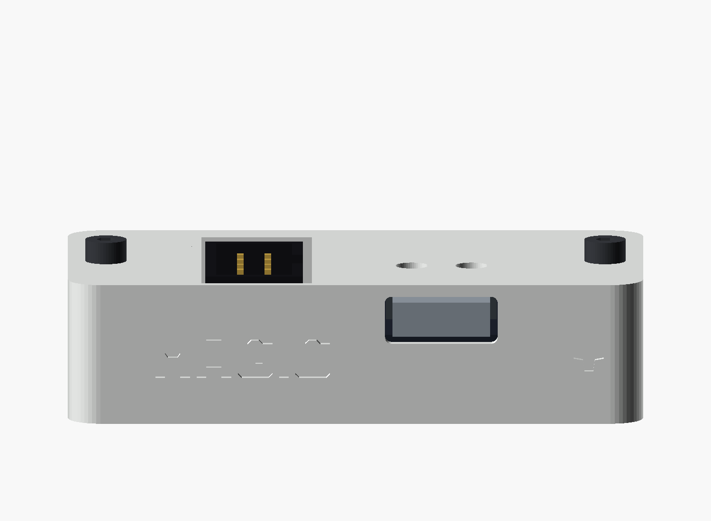
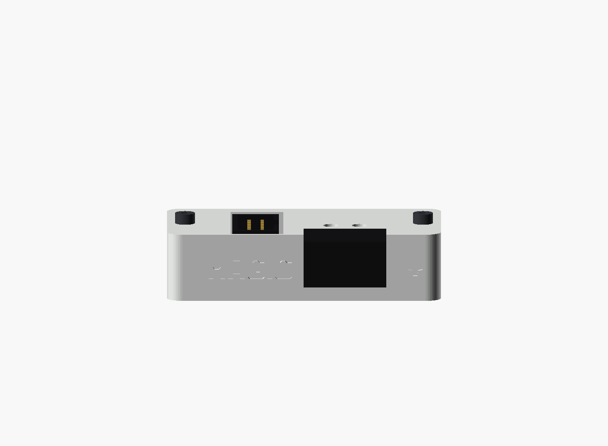
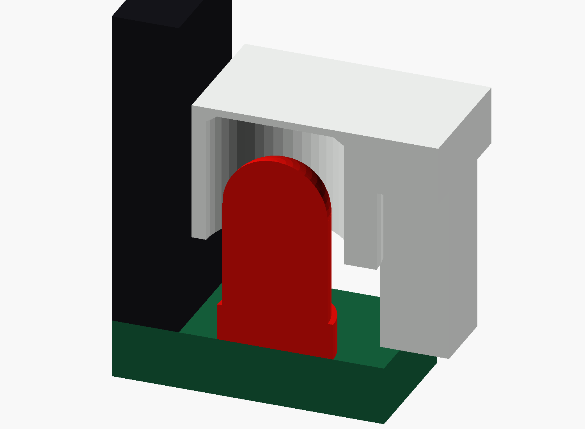

# TB2 C3 flat dock

A compact, two-piece dock for a **directly soldered ESP32-C3 SuperMini on the TB2 C3 Dev Shield Rev. 0.1**. The module sits one standard pinheader spacer above the shield, modeled here as 2.5 mm. The PCB sits close to the base floor, and a flat white roof covers the ESP32. A framed USB-C port is in the front wall; 3-mm holes provide tool access to BOOT and RESET. The shrouded cable connector and power jumper remain accessible from above. ACT stays behind a continuous, single-layer white skin and a light-guiding tube. **MAGIC** lettering remains on all four sidewalls.

**Enclosure Rev. 0.8 — unverified build candidate.** The meshes and component envelopes have been checked digitally. No print or physical fit test has been performed. The electronics in these previews are simplified dimensional references.

For an ESP32 whose pins extend **4.5 mm below its PCB**, see the separate [Model B](model-b/README.md). It keeps the one-spacer mounting height and models the resulting 0.4-mm pin tips beneath the shield.


**Use the Rev. 0.8 base and lid together.** This enclosure fits a directly soldered module with one pinheader spacer. The base has solder relief wells; the lid includes the ESP32 roof, ACT light channel and enclosed USB-C port.

## Orientation

Viewed from above with USB-C at the top: the ESP32 is on the left, POWER is at the upper right, J1 is below POWER, and ACT is at the lower right under the white skin. This matches the PCB top view.


## Files

| File | Use |
|---|---|
| [TB2_C3_Case.scad](TB2_C3_Case.scad) | Editable, standalone OpenSCAD source |
| [TB2_C3_Case_base.stl](TB2_C3_Case_base.stl) | Base, already oriented with its floor on the print bed |
| [TB2_C3_Case_lid.stl](TB2_C3_Case_lid.stl) | Lid, already oriented with its outside face on the print bed |
| [Exploded view](exploded.png) | Parts and assembly arrangement |
| [Top view](top.png) / [section](section.png) / [print layout](layout.png) | Internal clearances and print orientation |
| [LED cutaway](led_section.png) | Tube, LED and single-layer cover in section |
| [USB front view](usb_front.png) | Enclosed USB-C port in the front wall |
| [Plugged-cable envelope](usb_connected.png) | Modeled 16 × 9 mm cable housing outside the front wall |
| [Validation results](validation.json) | Mesh hashes and nominal collision results |

## Size and hardware

| Item | Nominal value |
|---|---|
| Printed enclosure, assembled | **53 × 27.72 × 13.0 mm** |
| USB shell top / assembled height without cables, including screw heads | About **11.3 / 15.0 mm**, dependent on the module and headers |
| Shield PCB | 39 × 22.52 × 1.6 mm |
| Floor / walls / ESP32 roof | 1.6 / 1.8 / 1.2 mm; front wall 1.0 mm beside the PCB; local solder wells retain 0.8 mm floor |
| White skin over ACT | **0.2 mm**, one layer with a 0.2 mm first-layer height; nominal 3.4 mm clearance above the seated LED |
| ACT tube | 3.8 mm entry bore, tapered to 3.2 mm beneath the skin; projects 5.0 mm below the lid roof |
| USB-C front port | **10.4 × 4.4 mm**, rounded; continuous 1.1-mm bridge above the opening |
| PCB underside above the inside floor | **0.8 mm**; solder wells give 1.6 mm depth from the PCB underside |
| Solder lead limit | At most **1.3 mm below the PCB including solder**, leaving 0.3 mm above the well floor |
| BOOT / RESET access | Two 3-mm holes for a blunt, nonconductive tool; nominal centers from the module drawing |
| PCB lateral clearance / vertical retention gap | 0.15 mm per side / 0.2 mm nominal |
| ESP32 pinheader spacer between PCBs | 2.5 mm nominal; no tall sockets in this enclosure |
| Fasteners | **2 × M2×8 cylinder-head screws**, nominal head Ø3.8 × 2 mm |
| Inserts | **2 × M2 heat-set inserts, 3 mm long, nominal Ø3.2 mm outside** |
| Insert seats | Ø3.2 mm, with an entry chamfer; insert top 0.2 mm below its boss |

The screws sit outside the PCB. Four small edge supports and matching lid retainers locate it without drilling the board. The screw load is carried by plastic bosses, not by the PCB. The supplied geometry gives 3 mm of insert thread engagement and 0.8 mm clearance below the screw tip.

The dock is designed for a module **soldered directly to the shield through normal male pinheaders**, leaving one plastic pinheader spacer between the two PCBs. Its PCB stands 0.8 mm above the normal interior floor; four shallow wells make room for clipped through-hole leads while leaving full-thickness ribs between them. The PCB must not rest on a solder joint. A version with tall female sockets needs a different enclosure. Different header spacers, modules, LEDs, cable plugs or insert profiles can require parameter changes. A nominal insert diameter does not guarantee the same heat-fit behaviour across brands or printers.

## USB-C access

The front face now sits 1.2 mm ahead of the shield PCB edge, close to the modeled receptacle mouth. The roof is continuous above USB-C. A rounded **10.4 × 4.4 mm** opening clears the modeled 9.0 × 3.2 mm receptacle shell. The modeled **8.4 × 2.4 mm**, 6.65-mm-long metal plug enters the opening while its **16 × 9 mm** cable housing stays outside the front face. The printed front bridge is 1.1 mm high. This layout assumes the real cable's metal tip projects far enough beyond its plastic housing to seat fully; that and the actual SuperMini receptacle position need a physical fit check. The `MAGIC` word and small star flank the port.





## Covered ESP32 and buttons

The roof covers the ESP32 and the USB-C shell; only the two small button holes interrupt that part of the top face. With USB at the top, **BOOT is the left hole and RESET the right hole**. Their nominal centers are 8.8 and 14.3 mm from the shield's left PCB edge, both 8.7 mm from its USB edge. Those coordinates are estimated from the [NologoTech SuperMini drawing](https://www.nologo.tech/product/esp32/esp32c3/esp32c3supermini/esp32C3SuperMini.html), not guaranteed dimensions of every SuperMini variant. Compare your soldered module with the lid before relying on the holes. Use a blunt, nonconductive tool rather than forcing a finger into them.

## ACT light channel

The lid includes a closed tube around the upper LED body, ending at the continuous white skin. Its outside is 5.6 mm across and flattened toward J1 to fit the narrow gap. The wall is 0.9 mm around most of the entry bore and **0.4 mm at its narrowest point beside J1**. There is no separate light pipe or insert to assemble.



The LED reference uses the Kingbright mounting envelope of 5.4 ± 0.5 mm above the PCB, with the LED fully seated. The tolerance check includes the LED and header size envelopes, ±0.15 mm PCB movement in X/Y and 0.2 mm upward movement. The modeled minimum gap to J1 is only **0.05 mm** at the combined envelope limit. Print variation and solder-placement errors are not included: this tight fit still needs a physical check. The longer 3.4-mm nominal air gap beneath the white skin also needs a visibility check. Do not force the lid or enlarge the PCB locating clearance without checking the tube again.

## Print

Print one base and one lid. The supplied STLs are separate parts in their intended print orientation; do not rotate the lid upright for printing.

- White PLA, 0.4 mm nozzle, **0.2 mm first layer and subsequent layers**. The first layer of the inverted lid forms the LED skin. The thinnest floor beneath the solder wells is four 0.2-mm layers. Suggested starting settings: four perimeters, five top/bottom layers and 20% infill.
- Both base and lid are white. The recessed `MAGIC` lettering and stars can be left white or paint-filled with the original orange accent colour. These are single-material STL parts; no separate colour inlay is required.
- Supports are not expected for the intended orientation. Inspect your slicer's preview, especially the 0.4-mm tube wall beside J1 and the small insert entry chamfers; this package has not been sliced or test-printed.
- Use a brim only if needed for adhesion. No printer-specific G-code is included.


## Assemble

1. Check that the shield, soldered ESP32 and actual connector bodies match the dimensions above. Remove the cable and power-jumper shunt; keep USB unplugged.
2. Install the two heat-set inserts in the **empty base**, before adding electronics. Set their top faces 0.2 mm below the boss surfaces. Let the base cool and check screw engagement.
3. Inspect the shield solder joints. Trim projecting leads to at most **1.3 mm below the PCB, including solder**, and remove loose clippings. Check that the pad locations align with the relief wells.
4. Place the shield with its **already soldered module** on the four edge supports. Orient the shield using its own USB arrow: the module is on the left and the cable connector on the right when looking down with USB at the top. The repeated `MAGIC` decoration is not an orientation mark.
5. Lower the lid vertically over the attached module. Its roof clears the module's top-side parts; its narrow opening surrounds the cable connector and jumper. The tube on the lid underside surrounds ACT; check that it clears the LED and J1. Its outer skin is closed; do not drill or puncture it. Do not force it onto a misplaced component.
6. Fit the two M2×8 screws and tighten gently until the lid seats. Its retainers should leave the designed small PCB clearance rather than bow the board.
7. Add your own jumper shunt and cable only after the normal electrical checks in the [hardware guide](../docs/hardware.md#first-use-checks).

Check full USB plug seating through the front port, access to both ESP32 buttons, SOP8 cable insertion/removal and jumper removal with the cable fitted. The connector apertures remain open; the dock is not sealed.


## Modify and validate

Open `TB2_C3_Case.scad` in OpenSCAD. Select `assembly`, `exploded`, `section`, `led_section`, `layout`, `base` or `lid` with the `part` parameter. The `base` and `lid` outputs export only the selected printable part. Fit, light-channel, header-spacer and fastener parameters are grouped near the top of the source.

With Python 3, OpenSCAD and PrusaSlicer installed, run from the repository root:

```sh
python enclosure/tools/validate.py
python enclosure/tools/validate.py --preview-only
python -m unittest discover -s enclosure/tools -p "test_*.py"
```

If needed, set `OPENSCAD` and `PRUSASLICER` to their executable paths. The checker exports both STLs, checks closed edges and connected components, and asks PrusaSlicer to check each mesh. It also checks nominal solid intersections for the enclosure, hardware, fasteners, USB and cable envelopes, plus the lid path over the already attached module. Mesh probes check the closed roof, button holes and solder wells against the released PCB layout. A separate solid probe verifies that the ACT cover is present and exactly 0.2 mm thick.

A separate orientation check reads the released `hardware/design.json` and probes the actual delivered lid STL at D1, J1 and JP1. Its regression test deliberately reflects the mesh and requires rejection. This check is independent of the simplified hardware reference used for collision checks.

The USB check reads the same independent PCB layout to locate the module center. It probes the exported base and lid across the metal plug's 8.4-mm width, requiring the lower sill, top bridge and both side shoulders. The modeled 16 × 9 mm cable housing stops outside the front face; the narrower metal tongue is swept through the port and checked for solid interference separately. This checks the chosen model, not an unmeasured cable.

The tube check probes the delivered STL at 72 positions around D1, requiring a continuous wall that extends below the roof. Its negative test rejects a flat roof without the tube. A separate solid-intersection check covers the LED, J1 and R2 envelopes at the extremes of the modeled PCB movement.

PCB layout coordinates have Y increasing down the drawing. The CAD output converts them to Cartesian Y increasing upwards. The engraving is kept readable during that conversion; the lid then receives its separate outside-down print rotation.

Shared, zero-thickness seating planes are reported separately from solid interference. Both printable meshes must be manifold and contain exactly one connected part. Check logs are kept in the ignored `.build/` directory.

The LED tube leaves a continuous white outer surface with no separate circular insert. Light transmission and visibility through the white PLA depend on pigment, extrusion and the actual LED; they remain untested.

The source uses the shield's [released layout dimensions](../hardware/design.json). Component references are the [Würth 61200821621 shrouded header](https://www.we-online.com/components/products/datasheet/61200821621.pdf), [matching 61200823021 cable connector](https://www.we-online.com/components/products/datasheet/61200823021.pdf), [Kingbright WP710A10LID LED](https://www.kingbrightusa.com/images/catalog/SPEC/WP710A10LID.pdf) and [ESP32-C3 SuperMini module](https://github.com/NologoTech/ESP32C3-Supermini). The modeled 6.65-mm USB-C plug tongue is based on the [USB-IF connector specification](https://www.usb.org/sites/default/files/USB%20Type-C%20Spec%20R2.0%20-%20August%202019.pdf). The male header spacer, module thickness, button centers, solder tails and mating cable envelope are nominal assumptions; measure the actual parts before relying on the fit.

### Still to verify physically

- Print shrinkage, insert seating and screw tightening.
- PCB support and retention, pinheader spacer height, solder-tail trimming and well-floor strength.
- USB, button, cable and jumper access; ACT visibility through the white skin.
- Strength during repeated cable insertion and removal.

The enclosure does not change the shield's electrical validation status. The source and accompanying files use the repository's [CERN-OHL-P-2.0 licence](../LICENSE).
