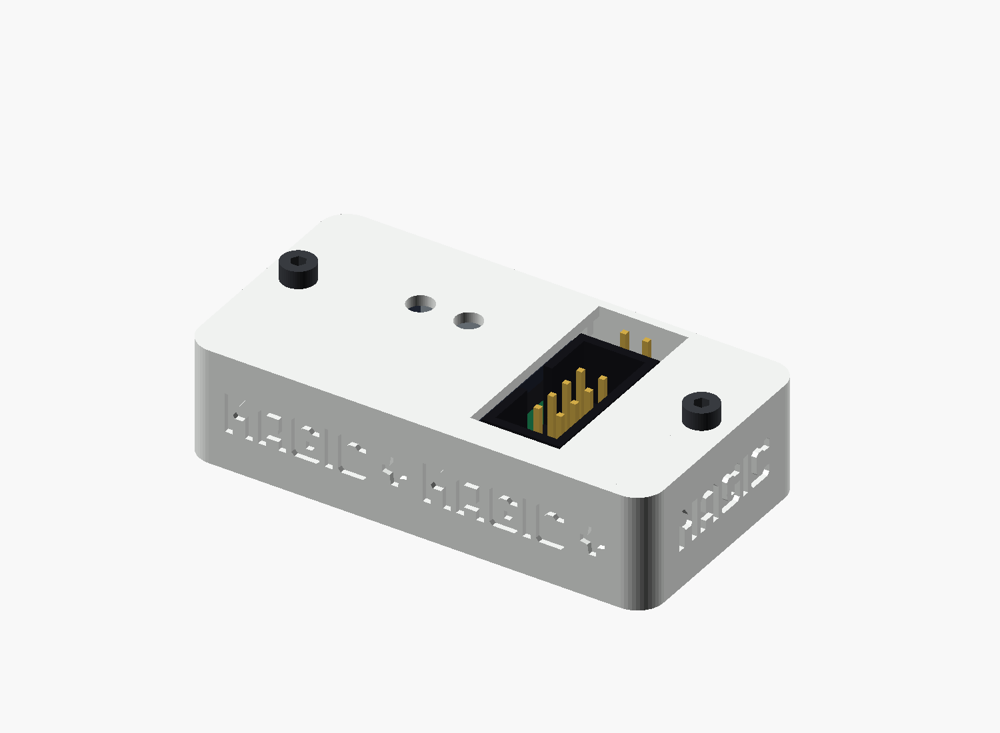

# Flat dock · Model B (4.5 mm ESP32 pins)

Model B is the two-piece flat dock for an ESP32-C3 SuperMini **soldered directly to the shield**. It assumes the male pins project **4.5 mm below the ESP32 PCB**, including the length occupied by the 2.5-mm plastic pinheader spacer. The spacer remains between the ESP32 and the 1.6-mm-thick shield:

| Part of the pin stack | Length |
|---|---:|
| Pin projection below the ESP32 PCB | 4.5 mm |
| Plastic spacer / PCB-to-PCB gap | −2.5 mm |
| Shield PCB thickness | −1.6 mm |
| **Bare pin tip below the shield** | **0.4 mm** |

This stack puts the ESP32 PCB at the **same height as [Model A](../README.md)**. The printable case therefore has the same outside shape and the same solder-relief wells; only the pin envelope in the editable Model B source and its digital fit check changes. The wells also accommodate the other through-hole parts, whose solder joints may project farther. Model B does **not** fit an ESP32 mounted in the factory-installed tall female sockets.

**Unverified build candidate:** 0.4 mm of bare pin beyond the shield is short. The model does not prove that every joint can be soldered reliably, or that its solder fillet fits the well. Inspect all 16 joints and measure the assembled ESP32-to-shield gap before printing several copies. The actual module, USB cable, SOP8 cable, printed parts and LED light transmission have not been physically fit-tested.



## Files

| File | Purpose |
|---|---|
| [TB2_C3_Case_B.scad](TB2_C3_Case_B.scad) | Editable Model B configuration; includes the [shared case source](../TB2_C3_Case.scad) |
| [TB2_C3_Case_base.stl](TB2_C3_Case_base.stl) | Base, floor down for printing |
| [TB2_C3_Case_lid.stl](TB2_C3_Case_lid.stl) | Lid, outside face down for printing |
| [Exploded view](exploded.png) / [USB front](usb_front.png) / [print layout](layout.png) | Assembly and print orientation |
| [Validation report](validation.json) | Source and STL hashes, calculated pin stack and mesh/clearance checks |

Print and assemble as described in the [common enclosure instructions](../README.md#print) and [assembly steps](../README.md#assemble). Use the **Model B base and lid together**. The USB-C port is enclosed by the front wall; the ESP32 is covered except for BOOT and RESET access holes. J1 and POWER remain accessible. The ACT light guide ends beneath a continuous 0.2-mm white skin. The case is 53 × 27.72 × 13.0 mm, excluding screw heads.

From the repository root, regenerate and check Model B with:

```sh
python enclosure/tools/validate.py --model-b
python enclosure/tools/validate.py --model-b --preview-only
python -m unittest discover -s enclosure/tools -p "test_*.py"
```

The checker reads the pin stack emitted by OpenSCAD and rejects a wrong exposed length, spacer height or shield thickness. It also checks the two meshes, the released PCB orientation, USB port, light guide, solder relief wells and nominal component collisions. These digital checks cannot establish solder quality or physical fit.
