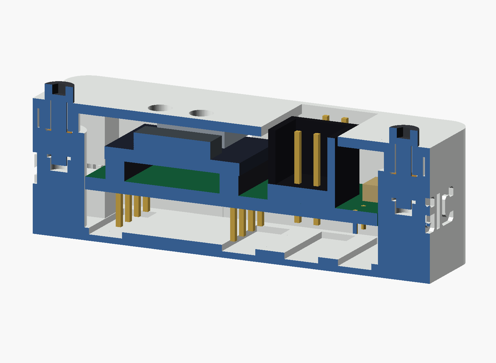

# Model B: 4.5 mm pins below the shield

Model B Rev. 0.9 accommodates pins extending **4.5 mm below the underside of the shield PCB**. There is **4.8 mm between the shield underside and the normal inside floor**, including 0.3 mm clearance below the pin tips. The existing solder wells provide additional space at the pads.

The ESP32-C3 remains directly soldered on one 2.5-mm pinheader spacer above the shield. This spacer and the shield thickness are **not subtracted from the required 4.5-mm space underneath the shield**. The support height, USB opening, component positions and closed roof move up together by 4 mm relative to [Model A](../README.md).

**Unverified build candidate:** the exported geometry is checked digitally. Actual print, solder joints, module dimensions, cable access and hardware fit still require physical verification.


## Dimensions

All Z heights below are measured from the outside bottom of the base.

| Feature | Model B Rev. 0.9 |
|---|---:|
| Outside dimensions, excluding screw heads | **53 x 27.72 x 17.0 mm** |
| Normal inside floor | 1.6 mm |
| Shield underside / support tops | **6.4 mm** |
| Space below shield over normal floor | **4.8 mm** |
| Pin projection below shield | **4.5 mm** |
| Pin tips / clearance above normal floor | 1.9 mm / **0.3 mm** |
| Local solder-well floor / pin-tip clearance | 0.8 mm / 1.1 mm |
| Shield top | 8.0 mm |
| ESP32 PCB underside / top | 10.5 / 12.1 mm |
| USB metal shell top | 15.3 mm |
| USB opening bottom / top | 11.5 / 15.9 mm |
| Roof underside above the ESP32 / outside top | 15.8 / 17.0 mm |
| USB top bridge | 1.1 mm |

Four edge seats, two on each side, support the shield at Z = 6.4 mm. Each seat contacts 4 mm of the board edge along its length. Matching lid retainers leave 0.2 mm vertical play. The pins do not support the board.



## Printable files

Use this base and lid together. The former 13-mm Model B package did not provide the required space below the shield and is superseded by Rev. 0.9.

| File | Purpose |
|---|---|
| [TB2_C3_Case_B_corrected.3mf](TB2_C3_Case_B_corrected.3mf) | Base and lid as two separate objects, positioned for printing; no printer profile |
| [TB2_C3_Case_base.stl](TB2_C3_Case_base.stl) | Base, outside floor down |
| [TB2_C3_Case_lid.stl](TB2_C3_Case_lid.stl) | Lid, outside face down |
| [TB2_C3_Case_B.scad](TB2_C3_Case_B.scad) | Editable configuration using the [shared source](../TB2_C3_Case.scad) |
| [Exploded view](exploded.png) / [USB view](usb_front.png) / [print layout](layout.png) | Assembly and orientation |
| [Validation report](validation.json) | Mesh, pin-clearance, support, USB and collision checks |

The ESP32 and USB shell remain covered by the roof; only the BOOT/RESET tool holes interrupt the ESP32 cover. J1 and POWER remain accessible from above. The ACT light channel ends beneath a continuous 0.2-mm white skin. MAGIC lettering remains on the sidewalls.

Follow the [common printing instructions](../README.md#print), using white filament and a 0.2-mm first layer. The M2x8 screws and 3-mm inserts remain the same: their seats rise with the lid. Use the Model B pin limit of **4.5 mm below the shield** instead of Model A's 1.3-mm trimming limit. Place the shield on all four seats before fitting the lid; check that solder joints and pin tips clear the floor.

## Regenerate and check

From the repository root:

```sh
python enclosure/tools/validate.py --model-b
python enclosure/tools/validate.py --model-b --preview-only
python enclosure/tools/package_3mf.py --force
python -m unittest discover -s enclosure/tools -p "test_*.py"
```

The checks probe the actual exported meshes at all module pins and at the four support seats. They require the full 4.5-mm pin space, the raised USB port and a closed roof; the old 13-mm geometry fails these checks. Additional checks cover manifold meshes, nominal hardware/cable collisions, lid insertion, button access and the ACT channel. These checks do not establish physical fit or print strength.
